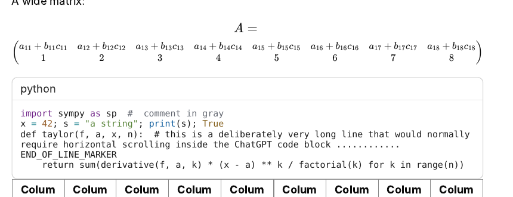

# Tabby · ChatGPT → PDF

[English](#english) · [中文](#中文)

**⬇️ Download / 下载:** [chatgpt-to-pdf-extension.zip](https://github.com/TabbyMao/tabby-chatgpt-pdf/releases/latest/download/chatgpt-to-pdf-extension.zip)

---

## English

A Chrome extension that exports a **complete** ChatGPT conversation to PDF, or sends it to a printer, and keeps the layout you see in ChatGPT.

### Features

- **Nothing missing:** the extension scrolls through the whole chat first so that every message is loaded. Long code blocks that have their own scrollbar are read line by line, so the whole block is included.
- **Same layout as ChatGPT:** message bubbles, headings, tables and lists keep their look. Buttons, timestamps and "You said:" labels are removed.
- **LaTeX math:** formulas are exported exactly as ChatGPT renders them.
- **No horizontal scrolling:** long code lines wrap. Long equations break at `=`, `+` and `−` outside parentheses. Wide tables and matrices shrink to fit the page.
- **Ink-saving code blocks** (can be turned off): code blocks print on a white background. Syntax colors keep their hue (purple stays purple, green stays green) and are only darkened so they stay readable.
- 12 mm page margins whatever the print dialog's margin setting is. Dark mode is switched to light only during the export.

### Install

1. [Download the zip](https://github.com/TabbyMao/tabby-chatgpt-pdf/releases/latest/download/chatgpt-to-pdf-extension.zip) and unzip it into a folder you will keep.
2. Open `chrome://extensions` (or `edge://extensions`).
3. Turn on **Developer mode** (top right).
4. Click **Load unpacked** and select the `extension` folder, the one that contains `manifest.json`.
5. Reload ChatGPT.

To update, unzip the new version over the old folder, click ↻ on the extension card, then reload ChatGPT.

If you use Tampermonkey, you can install [`chatgpt-to-pdf.user.js`](chatgpt-to-pdf.user.js) instead. It behaves the same.

### Use

1. Open a ChatGPT conversation and click the **PDF** button at the top right.
2. Wait a few seconds while it loads the full chat, then check the preview.
3. Click **Save as PDF**. A new tab opens with the print dialog:
   - **Destination:** *Save as PDF* or your printer.
   - **More settings → Background graphics:** turn this on.

### Notes

- Needs Chrome or Edge 111 or newer.
- ChatGPT changes its page often. If the extension stops finding messages, please open an issue.
- Content in the ChatGPT Canvas side panel is not part of the chat and is not exported.

---

## 中文

一个 Chrome 扩展：把 ChatGPT 对话**完整**导出成 PDF，或者直接用打印机打印，排版和 ChatGPT 里看到的一样。

### 功能

- **不遗漏：** 导出前会自动把整个对话滚动一遍，把所有消息都加载出来。带滚动条的长代码块会一行一行读取，所以整段代码都会导出。
- **排版不变：** 消息气泡、标题、表格、列表都保持原样。按钮、时间戳和 "You said:" 这类标签会去掉。
- **LaTeX 公式：** 公式和 ChatGPT 里显示的完全一样。
- **不用横向拖动：** 代码长行会自动换行。长公式只在括号外的 `=`、`+`、`−` 处断行。太宽的表格和矩阵会缩小到页面宽度。
- **省墨代码块**（可以关闭）：代码块打印成白底。语法高亮的颜色保持原来的色相（紫色还是紫色，绿色还是绿色），只是调暗一些，保证看得清。
- 不管打印对话框里的边距怎么设，页边距都是 12mm。深色模式只在导出时临时切成浅色。

### 安装

1. [下载 zip](https://github.com/TabbyMao/tabby-chatgpt-pdf/releases/latest/download/chatgpt-to-pdf-extension.zip)，解压到一个会一直保留的文件夹。
2. 打开 `chrome://extensions`（Edge 浏览器是 `edge://extensions`）。
3. 打开右上角的「**开发者模式**」。
4. 点「**加载已解压的扩展程序**」，选择 `extension` 文件夹，也就是里面有 `manifest.json` 的那个。
5. 刷新 ChatGPT 页面。

更新时，把新版本解压覆盖到原来的文件夹，在扩展卡片上点 ↻，再刷新 ChatGPT 页面。

如果你装了 Tampermonkey，也可以改装 [`chatgpt-to-pdf.user.js`](chatgpt-to-pdf.user.js)，效果相同。

### 使用

1. 打开一个 ChatGPT 对话，点右上角的 **PDF** 按钮。
2. 等几秒，让它加载完整个对话，然后查看预览。
3. 点 **Save as PDF**，会打开一个新标签页并弹出打印对话框：
   - **目标打印机：**选「另存为 PDF」或者你的打印机。
   - **更多设置 → 背景图形：**勾选。

### 说明

- 需要 Chrome 或 Edge 111 及以上版本。
- ChatGPT 经常改版。如果扩展找不到消息了，请提一个 issue。
- ChatGPT「画布 Canvas」侧边栏里的内容不在对话流里，不会导出。
